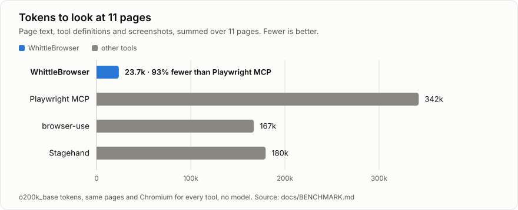
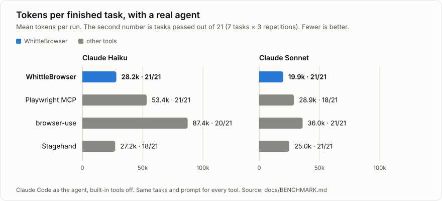

# WhittleBrowser

An open-source engine that lets AI agents use a Chromium browser. Pages are shown to models as **compact,
ref-stable, diffed text**, secrets and hidden prompt injections are **kept away from the LLM**, and sensitive
sites and irreversible actions wait for a person. It runs as an MCP server and as a TypeScript library.

- `packages/engine`: the protocol (in-page agent in a CDP isolated world, serializer, differ, privacy
  filter, detectors), a Playwright/CDP driver and an MCP server (`whittlebrowser`).
- The WhittleBrowser desktop browser (per-site AI, X-ray, ghost cursor, built-in chat, Demo Studio) is developed in a separate repository and is not released yet. The engine here works on its own with any MCP client.
- `website`: the animated landing page and docs site (`pnpm --filter @whittlebrowser/website dev`).

See [docs/COMPARISON.md](docs/COMPARISON.md) for how it compares, [docs/PROTOCOL.md](docs/PROTOCOL.md) for the format,
and [docs/BENCHMARK.md](docs/BENCHMARK.md) for the numbers.

## Benchmark: WhittleBrowser vs Playwright MCP, browser-use and Stagehand

Same 11 pages (5 test pages + 6 live sites), same Chromium, each tool's own code, o200k tokens, no LLM calls. Full methodology and charts are in [docs/BENCHMARK.md](docs/BENCHMARK.md).

<picture>
  <source media="(prefers-color-scheme: dark)" srcset="docs/img/benchmark-pages-dark.svg">
  
</picture>

| | Playwright MCP | browser-use | Stagehand | **WhittleBrowser** |
|---|---:|---:|---:|---:|
| page text, 11 pages | 300,898 | 29,836 (+ screenshots) | 172,176 | **13,282** |
| all-in incl. prompts/tool defs/screenshots | 342,115 | 167,061 | 179,557 | **23,699** |
| WhittleBrowser uses | 93% fewer | 86% fewer | 87% fewer | |
| planted secrets reaching the model | 7 / 7 | 6 / 7 | 6 / 7 | **0 / 7** |
| hidden prompt injections reaching the model | 5 / 5 | 3 / 5 | 4 / 5 | **0 / 5** |

With a real model driving each tool (Claude Haiku and Sonnet through Claude Code, 7 tasks, 3 repetitions each), the saving on whole tasks is smaller and depends on the task: large or re-rendering pages save the most, small pages save little. Every tool finished most tasks; the numbers after the dot are tasks passed.

<picture>
  <source media="(prefers-color-scheme: dark)" srcset="docs/img/benchmark-agent-dark.svg">
  
</picture>

Regenerate the charts after a new run with `pnpm --filter @whittlebrowser/engine bench:charts`.

## Quick start

```bash
git clone https://github.com/vasanth7781/whittlebrowser-engine.git && cd whittlebrowser-engine
pnpm install
pnpm --filter @whittlebrowser/engine build
npx playwright-core install chromium   # once

pnpm test        # engine unit + browser + MCP tests (headless)
pnpm bench       # benchmark (add -- --live --pw-mcp; run packages/engine/bench/compare/setup.sh once for browser-use + Stagehand)
```

### Use it from Claude Code (or any MCP client)

```bash
pnpm connect          # adds the server to Claude Code, and prints the JSON for Cursor, VS Code and other clients
pnpm connect codex    # adds it to Codex instead
pnpm connect desktop  # adds it to Claude Desktop (then quit and reopen the app)
pnpm connect skill    # installs the skill that teaches Claude how to use the tools well; pnpm connect all does everything
```

That runs `claude mcp add whittlebrowser -- node <this checkout>/packages/engine/dist/mcp/cli.js` (or `codex mcp add …`). Any extra arguments go to the
server, for example `pnpm connect --headless`. Setup for each client: [docs/use-with-ai-tools.md](docs/use-with-ai-tools.md).

Flags: `--headless`, `--ephemeral`, `--profile DIR`, `--channel chrome`, `--budget N`,
`--allow-site HOST` (override auto-pause), `--risk confirm|auto|deny`, `--robots off|warn|enforce`,
`--default-off`, `--no-identify`, `--allow-file-urls`, `--humanize`, `--host` (use a host app's policy, see [docs/CONTROL.md](docs/CONTROL.md)), `--bot-key FILE --bot-agent URL` (Web Bot Auth).

Secrets for `type secret:NAME`: env `WB_SECRET_NAME=…` or `~/.whittlebrowser/secrets.json` (chmod 600).

## Tools

Nine MCP tools with short schemas (the whole list is about 1,000 tokens):

| Tool | What it does |
|---|---|
| `observe` | Compact view of the page (or one subtree) within a token budget |
| `act` | One or more steps (click, type, select, check, hover, press, scroll, upload); returns outcome + diff |
| `navigate` | URL, search words, back, forward, reload |
| `find` | Search the whole page, including off-screen, ranked. `role:button pay` filters by role; `css:SELECTOR` counts visible matches and lists their class and attributes |
| `extract` | `table`, `list` (repeated cards as rows), `text` (main content as markdown), paged |
| `research` | Open several pages in parallel and return a compact digest of each |
| `tabs` | list, open, switch, close |
| `screenshot` | JPEG with sensitive fields blurred (last resort) |
| `wait` | For text, for a delay, or hand control to you (CAPTCHA, 2FA) |

Full argument reference: [docs/PROTOCOL.md](docs/PROTOCOL.md).

## How it stays cheap

1. The in-page agent prunes the DOM in one pass: roles, accessible names, states, visibility, refs.
2. The serializer flattens wrappers, merges inline runs, deduplicates labels, folds repeated siblings,
   and fits a token budget.
3. Actions return outcome + diff, not the page. Steps can be batched.
4. `find` and `extract` answer targeted questions without reading the whole page.

## How it stays safe

- Isolated-world agent; hidden and deceptive text dropped; ⚠ on instruction-like text.
- Sensitive values masked in the page; one scrubbing choke point; reversible tokens; local vault.
- Per-site AI modes (`--default-off`, or Off per site when a host app owns the policy), auto-pause on banking, consoles, and card/ID/key pages.
- Approval for irreversible actions, data-carrying cross-site jumps, and uploads outside a sandbox dir.
- Honest identity: UA token, Web Bot Auth signatures, robots.txt, CAPTCHA handoff to the human.
  No fingerprint spoofing and no CAPTCHA solving.

## Layout

```
packages/engine/src/page/agent.ts     in-page agent (isolated world)
packages/engine/src/core/             serializer, diff, privacy, detector, injection, risk, robots, web bot auth
packages/engine/src/driver/           session (observe/act/find/extract/...), policy, launch
packages/engine/src/mcp/              MCP server + CLI
packages/engine/test, bench           tests, fixtures, benchmark
website/                              landing page and docs site (renders docs/*.md)
```

## License

MIT, see [LICENSE](LICENSE). Contributions are welcome: see [CONTRIBUTING.md](CONTRIBUTING.md). Report
security issues privately, see [SECURITY.md](SECURITY.md). The host control protocol that lets an app embed
the engine is in [docs/CONTROL.md](docs/CONTROL.md).
